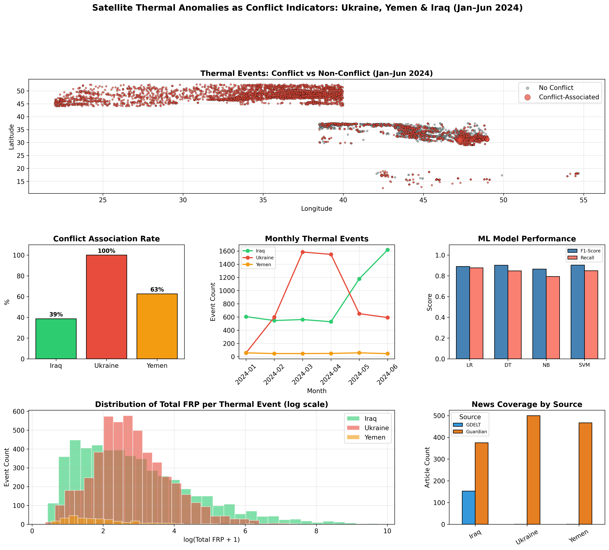
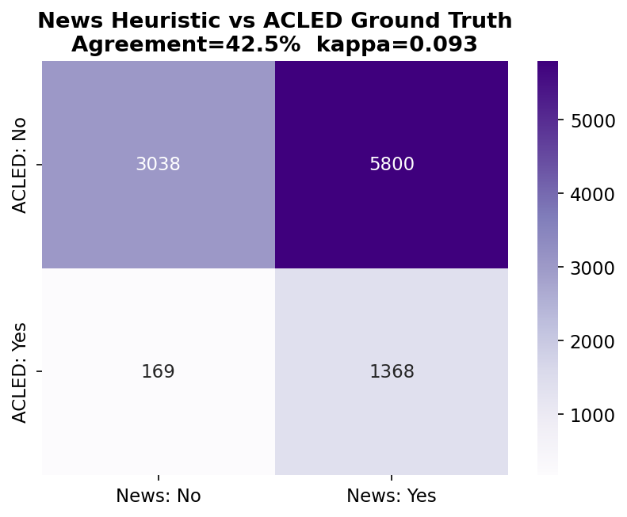
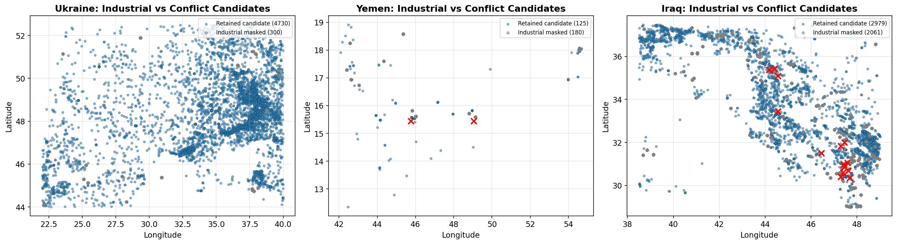
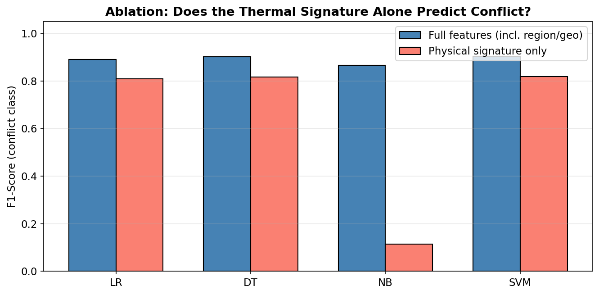
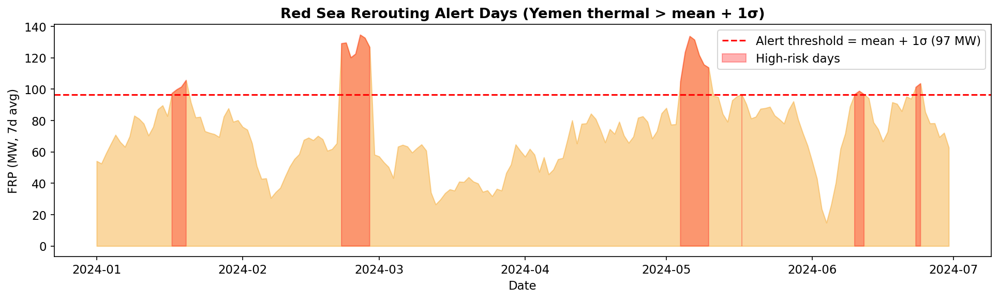

# Conflict Situation Monitoring for Maritime Shipping
### Correlating Satellite Thermal Anomalies with Armed Conflict & Market Impact

**Team:** Ahmet Emre Bingöl & Ayda Tuna  
**Institution:** Boğaziçi University — CE49X: Introduction to Data Science for Civil Engineering  
**Analysis Window:** January 1, 2024 – June 30, 2024 (2024 H1)  
**Study Regions:** Ukraine (Black Sea), Yemen (Red Sea / Bab el-Mandeb), Iraq (Persian Gulf)

---

## 1. Introduction & Executive Summary

Commercial maritime shipping routes pass through narrow geopolitical chokepoints that are vulnerable to armed hostilities. When regional conflicts erupt, merchant vessels face missile and drone threats, war-risk insurance premiums escalate, and shipping lines are forced to reroute cargo around the Cape of Good Hope, adding 10–14 transit days and millions of dollars in unexpected bunker fuel expenses.

This project develops an end-to-end geospatial situation monitoring pipeline that correlates satellite-detected thermal anomalies from NASA FIRMS with war/conflict news reporting and an independent ground-truth conflict event database (ACLED). The objective is to evaluate whether satellite thermal observations can provide reliable situation awareness and commercial decision support for shipping route diversion and fuel-cost hedging.

```
+---------------------------------------------------------------------------------+
|                                 DATA INGESTION                                  |
|   NASA FIRMS Satellites   |   Conflict News Feeds   |    ACLED Ground Truth     |
|   (144,201 VIIRS records) | (1,723 Guardian/GDELT)  |  (35,436 Verified Events) |
+---------------------------+-------------------------+---------------------------+
                                         |
                                         v
+---------------------------------------------------------------------------------+
|                    SPATIAL-TEMPORAL CLUSTERING & FILTERING                      |
|       DBSCAN Clustering (5 km, 3 days) -> 10,375 Discrete Thermal Events        |
|       3-Signal Industrial Flare Mask -> 2,541 Persistent Flares Filtered        |
+---------------------------------------------------------------------------------+
                                         |
                                         v
+---------------------------------------------------------------------------------+
|                         EVALUATION & RISK IMPLICATIONS                          |
|  * Target Leakage Ablation: Full F1=0.903 -> Physical-Only F1=0.819            |
|  * Ground-Truth Cross-Check: News Heuristic vs. ACLED Agreement = 42.5% (k=0.09)|
|  * Operational Fleet Scenario: 24 Alert Days -> ~$7.91M Extra Bunker Fuel Cost  |
+---------------------------------------------------------------------------------+
```

---

## 2. Real-World Problem & Business Motivation

Operating costs in international container and bulk shipping are tightly linked to transit distance and fuel consumption:

* **Chokepoint Vulnerability:** Armed hostilities in the Red Sea (Bab el-Mandeb) and the Black Sea directly threaten maritime corridors through which a substantial portion of global container traffic and grain transit.
* **Cost of Avoidance:** Avoiding the Red Sea via the Cape of Good Hope detour adds approximately 3,500 nautical miles (~10–14 days) per voyage. For a typical container vessel burning 200 tonnes of Very Low Sulphur Fuel Oil (VLSFO) per day at $600/tonne, a single reroute incurs approximately **$1.2 million in direct fuel expenditure**.
* **The Monitoring Challenge:** Operators need automated, objective indicators of regional escalation. While news media provides narrative context, reporting is subjective and prone to regional coverage saturation. Satellites offer objective physical measurements, but thermal sensors detect all heat sources—including petroleum extraction and industrial flares—without intrinsic knowledge of context.

---

## 3. Project Overview & Objectives

The project addresses these challenges through a three-theatre comparative study (Ukraine, Yemen, Iraq) over the first half of 2024:

1. **Ingest and Store Multi-Source Data:** Clean and persist 144k+ satellite observations, 1,700+ news articles, and 35k+ ground-truth events into a relational PostgreSQL database.
2. **Cluster Thermal Detections:** Aggregate sparse satellite observations into distinct spatio-temporal thermal events using DBSCAN.
3. **Disambiguate Industrial Flares:** Filter stationary oil and gas flaring from warfare-induced fires using geographic proximity and temporal persistence.
4. **Evaluate Predictive Classifiers:** Train supervised learning models to classify conflict association, and conduct rigorous feature ablation to uncover target leakage.
5. **Validate Against Verified Ground Truth:** Benchmark heuristic news labels against independent human-verified conflict data from ACLED.
6. **Quantify Financial Risk Scenarios:** Translate operational alert thresholds into concrete fleet rerouting cost estimates and evaluate commodity price relationships.

---

## 4. Key Findings & Quantitative Results

All figures reflect verified calculations from the executed analysis notebook:

| Metric / Result | Value | Analytical Significance |
|---|---|---|
| **Raw FIRMS Satellite Detections** | 144,201 | Nominal/high confidence VIIRS detections across Ukraine, Yemen, and Iraq. |
| **Clustered Thermal Events** | 10,375 | Aggregated via DBSCAN (5.0 km spatial radius, 3-day time window). |
| **Industrial Flares Masked** | 2,541 (24.5%) | 3-signal filter removed stationary petroleum burns (Iraq: 41%, Yemen: 59%, Ukraine: 6%). |
| **Spatial Autocorrelation (Moran's I)** | Iraq: 0.476, Yemen: 0.411, Ukraine: 0.114 ($p=0.001$) | Statistically confirms thermal anomalies form genuine spatial clusters, not random sensor noise. |
| **News Heuristic Agreement with ACLED** | 42.5% ($\kappa = 0.093$) | News-matching heuristics severely over-label conflict in heavily reported regions (Ukraine: 100% vs. 24% ground truth). |
| **Sensor Lead/Lag Cross-Correlation** | Ukraine: -10d ($r=0.17$), Yemen: -11d ($r=0.11$) | Thermal activity **lags** verified combat events; satellite detection provides situational verification, not early warning. |
| **ML Classification Performance (Full)** | SVM: Acc=0.874, F1=0.903 | Evaluated against news-matched proxy labels. Latitude accounted for 72.4% of feature importance (geographic leakage). |
| **Physical-Only Ablation Performance** | SVM: Acc=0.722, F1=0.819 | Removing coordinates and calendar features dropped F1 by only 0.084, confirming physical thermal features retain predictive signal. |
| **Illustrative Fleet Rerouting Exposure** | 24 Alert Days / $7,912,088 | Exceeding the mean + 1 standard deviation threshold (97 MW FRP) implies ~7 detours for an illustrative 50-voyage fleet. |
| **Correlation with Brent Crude Price** | $r = -0.03$ (weak/negligible) | Thermal anomalies in individual conflict regions do not drive global oil spot prices. |

---

## 5. Analytical Visualizations

### Executive Situation Monitoring Dashboard

*Figure 1: Multi-panel summary dashboard illustrating monthly thermal event frequency, total Fire Radiative Power (FRP) trends, day/night satellite detection ratios, and primary geographic hotspot coordinates across Ukraine, Yemen, and Iraq (Jan–Jun 2024).*

---

### Independent Conflict Validation: The News Heuristic Trap

*Figure 2: Confusion matrix comparing the initial news-matching heuristic against independent ACLED ground truth. The overall agreement was 42.5% with a Cohen's kappa of 0.093 (poor agreement), demonstrating that naive news-keyword matching produces substantial false positives in high-interest media theatres.*

---

### Industrial Flare Masking: Separating Petroleum Flares from Warfare

*Figure 3: Spatial separation of retained candidate conflict events versus masked industrial flares. By cross-referencing known oil/gas facilities with multi-month spatial persistence, 41% of Iraqi events and 59% of Yemeni events were identified as industrial burns, while frontline combat fires in Ukraine were preserved.*

---

### Model Ablation: Target Leakage vs. Physical Signatures

*Figure 4: Classifier performance comparison between Model B (full feature set including geographic coordinates) and Model A (physical thermal signature only: FRP, duration, detections, day/night ratio, brightness). Removing geography reduced SVM F1-score from 0.903 to 0.819 (a modest 0.084 drop), demonstrating that physical attributes carry genuine predictive signal.*

---

### Maritime Risk Implications: Red Sea Rerouting Alert Scenarios

*Figure 5: 7-day rolling average FRP in Yemen relative to an objective alert threshold (mean + 1 standard deviation = 97 MW). The threshold was breached on 24 of 182 days (13%), translating to approximately 7 rerouted voyages and $7.91M in illustrative fuel-cost exposure for a mid-sized commercial fleet.*

---

## 6. Technologies & Tools

* **Core Language:** Python 3.10+
* **Data Processing & Scientific Computing:** `pandas` (v2.x), `numpy` (v1.26), `scipy`
* **Machine Learning & Modeling:** `scikit-learn` (Logistic Regression, Decision Trees, Naive Bayes, Support Vector Machines)
* **Spatial Statistics & GIS:** `libpysal`, `esda` (Global Moran's I, Local Getis-Ord Gi\*), `folium` (interactive leaflet mapping)
* **Relational Database:** PostgreSQL 16 hosted via Docker, interfaced via `SQLAlchemy` and `psycopg2-binary`
* **Data Ingestion & APIs:** `requests`, `python-dotenv`, `yfinance`
* **Visualization:** `matplotlib`, `seaborn`

---

## 7. Data Pipeline & Methodology

```
[NASA FIRMS VIIRS] ──────► firms_detections ──────► DBSCAN Spatial-Temporal ─────► thermal_events
                                                           Clustering                     │
[The Guardian & GDELT] ──► news_articles ──────── Heuristic Matching ─────────────┤
                                                                                          ▼
[ACLED API] ─────────────► acled_events ───────── Ground-Truth BallTree Match ──► event_matches
                                                                                          │
[Oil Field Database] ────► 3-Signal Flare Mask ── Persistent Anomaly Check ──────► thermal_events_masked
                                                                                          │
                                                                                          ▼
                                                                                 Model Training &
                                                                                 Fleet Risk Scenarios
```

1. **Ingestion & Database Normalization:**
   * Satellite observations queried via NASA FIRMS REST API in 5-day chunks and filtered for nominal/high confidence.
   * News articles ingested from The Guardian Open Platform and GDELT v2 DOC API, deduplicated, and scoped to regional query terms.
   * Data persisted into six normalized PostgreSQL tables (`firms_detections`, `news_articles`, `thermal_events`, `event_matches`, `acled_events`, `thermal_events_masked`).
2. **Spatio-Temporal Clustering (DBSCAN):**
   * Satellite detections are discrete pixels. To identify discrete physical events, observations within $\epsilon = 5.0$ km and a temporal window of $\pm 3$ days were clustered, generating 10,375 discrete events with aggregated FRP, duration, and day/night ratios.
3. **Flare Masking Algorithm:**
   * A persistent cell grid identified clusters active across $\ge 3$ distinct months. Cells within 12 km of documented oil extraction facilities without nearby ACLED combat incidents were classified as industrial flaring (`is_industrial = True`).
4. **Spatial Autocorrelation:**
   * Global Moran's I and Local Getis-Ord Gi\* were calculated using spatial $k$-nearest-neighbor weights ($k=8$) to confirm non-random spatial clustering.

---

## 8. Machine Learning Evaluation & Independent Validation

### Model Comparison Against News-Derived Labels
Models were trained using an 80/20 stratified train/test split on 10,375 thermal events:

| Classifier | Full Features Accuracy | Full Features F1 | Physical-Only Accuracy | Physical-Only F1 |
|---|---|---|---|---|
| **Support Vector Machine (RBF)** | **0.874** | **0.903** | 0.722 | **0.819** |
| **Decision Tree (max_depth=5)** | 0.872 | 0.901 | **0.728** | 0.816 |
| **Logistic Regression** | 0.850 | 0.890 | 0.707 | 0.808 |
| **Gaussian Naive Bayes** | 0.829 | 0.865 | 0.330 | 0.115 |

### Critical Technical Nuance: The Risk of Over-Interpretation
* **Target Leakage Discovery:** In the full feature model, decision-tree feature importances showed that `centroid_lat` accounted for **72.4%** of model predictive weight, followed by month (16.6%). Because Ukraine had daily war coverage and high latitude, the model learned geographic location rather than the physical characteristics of warfare fires.
* **Interpretation of F1 = 0.903:** This score reflects how well the classifier predicts the *news-matching heuristic proxy label*, **not** real-world combat verification.
* **The Ground-Truth Gap:** Validating the news proxy against independent ACLED records revealed an agreement rate of only 42.5% ($\kappa = 0.093$). While physical thermal signatures retain predictive signal in the ablation experiment (F1 = 0.819), machine learning models trained on news labels cannot be treated as verified combat detectors without ground-truth calibration.

---

## 9. Maritime Shipping & Energy Market Implications

### Commercial Fleet Rerouting Decision Support
* **Threshold Logic:** By monitoring 7-day smoothed thermal FRP against an objective anomaly threshold (mean + 1 standard deviation = 97 MW), operations teams receive objective indicators of elevated regional kinetic activity.
* **Scenario Quantification:** Over the 182-day period, 24 days breached the alert threshold. For a hypothetical shipping company running 50 voyages through the Red Sea semi-annually:
  $$	ext{Expected Detours} = rac{24}{182} 	imes 50 pprox 6.59 	ext{ voyages}$$
  $$	ext{Extra Cost} = 6.59 	imes (10 	ext{ detour days} 	imes 200 	ext{ tonnes/day} 	imes \$600/	ext{tonne}) pprox \$7,912,088$$
* **Operational Nature:** These numbers are illustrative decision-support projections to help chartering desks evaluate war-risk insurance premiums versus Cape of Good Hope detours.

### Energy Market Benchmark
* Analyzing daily Basra thermal anomalies and Yemen FRP against ICE Brent crude futures ($BZ=F$) yielded a correlation of $r = -0.03$. 
* Global crude markets are driven by macroeconomic indicators, OPEC+ production quotas, and international inventories. Regional thermal spikes should be viewed as operational triggers to review local terminal exposures, not as econometric predictors of oil prices.

---

## 10. Limitations & Lessons Learned

1. **Sensor Lag:** Lead/lag cross-correlation proves that satellite thermal activity lags verified combat events by 10–11 days in Ukraine and Yemen. Satellite observations provide situational confirmation, not early warning.
2. **News Reporting Saturation:** Media attention is disproportionately allocated to major international conflicts. Naive keyword matching causes massive over-labeling in well-covered theatres.
3. **Cloud Cover & Satellite Revisit Windows:** Optical and infrared sensors (VIIRS) cannot penetrate heavy cloud cover or smoke plumes, creating intermittent temporal observation gaps.
4. **Third-Party Data Constraints:** Redistribution restrictions on ACLED data necessitate clean decoupling between committed repository artifacts and restricted raw records.

---

## 11. Reproducibility & Setup Instructions

### Prerequisites
* Python 3.10 or 3.11
* Docker Desktop (for the PostgreSQL service)

### 1. Launch PostgreSQL Container
Run the PostgreSQL 16 container:

```bash
docker run --name ce49x-postgres   -e POSTGRES_USER=ce49x   -e POSTGRES_HOST_AUTH_METHOD=trust   -e POSTGRES_DB=conflict_monitoring   -p 5432:5432   -d postgres:16
```

Verify that the database service is healthy:
```bash
docker ps
```

### 2. Configure Environment & Dependencies
Set up a clean virtual environment and install dependencies:

```bash
python3 -m venv .venv
source .venv/bin/activate  # On Windows: .venv\Scriptsctivate
pip install -r requirements.txt
```

### 3. API Keys Configuration (`.env`)
Create your local environment file:

```bash
cp .env.example .env
```

Edit `.env` with your registration keys:
* `FIRMS_MAP_KEY`: Free registration at [firms.modaps.eosdis.nasa.gov](https://firms.modaps.eosdis.nasa.gov/api/map_key/) (required for live FIRMS fetching).
* `GUARDIAN_API_KEY`: Free developer key at [open-platform.theguardian.com](https://open-platform.theguardian.com/access/) (required for live news fetching).
* `ACLED_USER` / `ACLED_PASS`: Registered at [acleddata.com/register](https://acleddata.com/register/) (optional; required only to refresh ACLED data from the live API).
* `DATABASE_URL`: Defaults to `postgresql://ce49x@localhost:5432/conflict_monitoring`.

### 4. Execute Analysis
Launch Jupyter Notebook and open the master analysis:

```bash
jupyter notebook notebooks/maritime_conflict_monitoring.ipynb
```

Execute cells sequentially or select **Kernel -> Restart & Run All**.

---

## 12. Credits & Citations

### Team & Equal Contributions
This project was designed and implemented equally by:
* **Ahmet Emre Bingöl** — Geospatial analysis, clustering, API ingestion pipelines, and ML modeling.
* **Ayda Tuna** — Data architecture, validation against ACLED ground truth, industrial flare filtering, and economic scenario analysis.

**Course Context:** CE49X: Introduction to Data Science for Civil Engineering, Department of Civil Engineering, Boğaziçi University (Spring 2026), instructed by Dr. Eyuphan Koç.

### Data Sources & Citations
1. **NASA FIRMS:** Near Real-Time Active Fire / Thermal Anomaly Data, Visible Infrared Imaging Radiometer Suite (VIIRS) 375m standard processing product.
2. **ACLED:** Armed Conflict Location & Event Data Project (ACLED); [acleddata.com](https://acleddata.com/).
3. **The Guardian:** The Guardian Open Platform Content API (2024).
4. **GDELT Project:** Global Database of Events, Language, and Tone (v2 DOC API).
5. **Yahoo Finance:** Historical Brent crude oil futures (`BZ=F`) time series.

---

## 13. License & Disclaimer
This repository is released under the [MIT License](LICENSE). The routing cost models and commodity analyses are academic decision-support simulations and do not constitute financial, legal, or maritime navigation advice.
